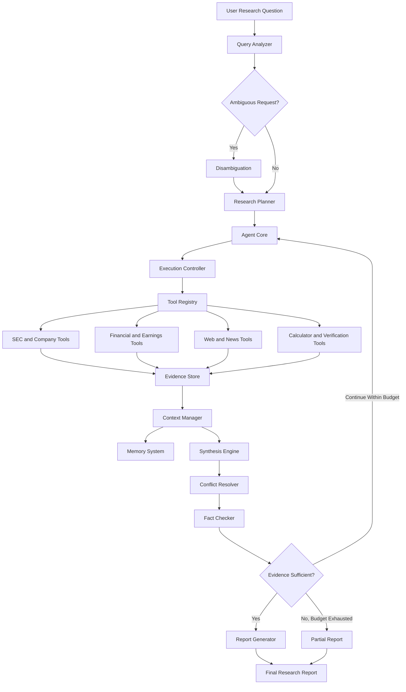

# Autonomous Financial Research Agent
## Architecture Specification

**Project:** Project 1A — Autonomous Financial Research Agent with Multi-Source Synthesis  
**Author:** Prashant Bastola  
**Version:** 1.0.0  
**Status:** Architecture specification  
**Repository:** Project1A-PrashantBastola-AutonomousFinancialResearchAgent

---

## 1. Executive Overview

The Autonomous Financial Research Agent is designed to investigate financial and company-related questions by planning research tasks, retrieving information from multiple sources, validating evidence, resolving conflicting information, and generating structured research reports.

The system combines a Plan-and-Execute strategy with a ReAct-style execution loop. Planning decomposes a research question into manageable tasks, while iterative execution allows the agent to adapt to new evidence, unavailable sources, and unexpected findings.

The architecture separates agent orchestration, research tools, memory, evidence synthesis, error handling, evaluation, and report generation. This separation supports independent testing, controlled tool execution, and future extension.

The system prioritizes factual accuracy, traceable evidence, transparent uncertainty, bounded execution, and graceful degradation. It must never fabricate missing information or silently conceal material conflicts.

This document defines the intended architecture and implementation contracts. A component is not considered implemented merely because it appears in this specification; implementation must be supported by working code and appropriate tests.

## 2. Purpose and Scope

### 2.1 Purpose

The purpose of the project is to build an autonomous research system capable of conducting structured financial research with minimal manual intervention.

The agent should:

- Understand and classify a financial research question.
- Identify the company, ticker, reporting period, and research objective.
- Develop an ordered research plan.
- Invoke registered tools to retrieve relevant information.
- Preserve evidence provenance and retrieval metadata.
- Compare financial information across independent sources where available.
- Identify contradictory values, definitions, and reporting periods.
- Verify important claims before report generation.
- Produce a structured report with citations and limitations.
- Recover from tool failures without fabricating evidence.
- Evaluate its research quality using repeatable tests and metrics.

### 2.2 Scope

The intended research sources include SEC EDGAR filings, financial data APIs, company disclosures, earnings information, news sources, and web search.

The system includes research planning, tool orchestration, memory management, evidence synthesis, conflict resolution, fact checking, reporting, logging, and evaluation.

### 2.3 Out of scope

The system is a research assistant, not an autonomous investment adviser. It must not issue investment recommendations or predictions.

The architecture does not assume that every external service is free, available, accurate, or accessible without credentials. API availability, terms, rate limits, and data coverage must be verified during implementation.

## 3. Architectural Goals and Principles

The design follows these principles:

1. **Evidence before assertion:** factual claims require identifiable supporting evidence.
2. **Source traceability:** evidence should preserve source identity, URL, retrieval time, and relevant reporting period.
3. **Independent corroboration:** important numerical claims should be checked against at least two sources where available.
4. **Explicit uncertainty:** missing, stale, contradictory, or unverified information must be labelled.
5. **Bounded autonomy:** each research run must enforce a maximum of 20 tool calls.
6. **Controlled capabilities:** the agent may invoke only registered and permitted tools.
7. **Schema validation:** tool inputs and outputs must follow explicit contracts.
8. **Graceful degradation:** partial research is preferable to fabricated completeness.
9. **Separation of concerns:** planning, execution, evidence management, synthesis, and reporting should be independently testable.
10. **Reproducibility:** structured logs should explain important decisions and execution outcomes.
11. **Data minimization:** credentials and unnecessary sensitive information must not enter prompts, logs, or persistent memory.
12. **Honest reporting:** the final report must accurately reflect what was and was not established.

## 4. High-Level Architecture



The diagram represents the intended logical design. It does not imply that all components have already been implemented.

### 4.1 Architectural layers

**Interaction and analysis layer:** receives and interprets research requests.

**Planning and orchestration layer:** creates research tasks, schedules actions, enforces limits, and manages the cognitive loop.

**Tool execution layer:** exposes validated research capabilities through the Tool Registry.

**Evidence and memory layer:** stores research observations, source metadata, active context, and relevant historical findings.

**Synthesis and verification layer:** combines evidence, resolves conflicts, and verifies claims.

**Reporting and evaluation layer:** produces the required report and evaluates system quality.

## 5. Component Responsibilities

### 5.1 Query Analyzer

The Query Analyzer converts natural-language questions into structured research requests. It extracts the target company, research objective, requested period, comparison targets, and output constraints.

It should distinguish explicitly provided values from uncertain interpretations. When a request is ambiguous, it should flag the ambiguity rather than silently inventing a missing identifier.

**Input:** user query and relevant permitted context.

**Output:** normalized research request with subject, objective, time scope, constraints, and ambiguity indicators.

### 5.2 Disambiguation

The Disambiguation component resolves uncertainty about company names, tickers, legal entities, exchanges, and reporting periods.

It should compare available identifiers and retain the evidence supporting entity selection. If the evidence cannot establish the intended subject, the agent should ask for clarification or clearly restrict the scope of its findings.

### 5.3 Research Planner

The Research Planner decomposes the research objective into ordered tasks. Each task should identify its objective, dependencies, expected evidence, suitable tool categories, and completion criteria.

For earnings research, tasks might include identifying the correct reporting period, retrieving official disclosures, obtaining comparative financial metrics, reviewing news, identifying risks, and verifying numerical claims.

The plan may be revised when evidence is insufficient or a source fails. Replanning must respect the tool-call budget.

### 5.4 Agent Core

The Agent Core coordinates planning, execution, observations, memory updates, verification, and report generation.

It tracks pending and completed tasks, evidence identifiers, unresolved questions, errors, and remaining tool calls.

The core must not treat a successful HTTP response as proof that its content is correct. It must inspect the result, validate its structure, and assess whether it supports the intended claim.

### 5.5 Execution Controller

The Execution Controller enforces operational constraints, including the maximum of 20 tool calls per research run, timeouts, retry limits, and approved tool access.

A tool call is counted whenever the system invokes a registered tool. Retries must be counted consistently; they must not bypass the budget.

The controller should prevent execution when a proposed action is invalid, unauthorized, unnecessary, or outside the remaining budget.

### 5.6 Tool Registry

The Tool Registry exposes approved capabilities through stable names, descriptions, input schemas, output contracts, and error conventions.

It should validate arguments before invocation, record execution outcomes, and return normalized results or structured errors.

The agent must not execute arbitrary model-generated code or invoke unregistered functions.

### 5.7 Evidence Collector

The Evidence Collector normalizes tool responses into evidence records. It preserves source attribution, retrieval timestamps, reporting periods, units, and relevant verification information.

It should distinguish a primary source from a secondary source and avoid treating duplicated copies of the same underlying report as independent corroboration.

### 5.8 Context Manager

The Context Manager selects relevant evidence for the current task, controls the active context, tracks research progress, and provides the synthesis engine with appropriately scoped information.

It should retain references to original evidence rather than removing provenance when summarizing information.

### 5.9 Synthesis Engine

The Synthesis Engine combines verified evidence into a coherent explanation. It should identify agreements, disagreements, missing information, and changes across reporting periods.

The engine must distinguish reported facts, derived calculations, external estimates, and analytical interpretations.

### 5.10 Conflict Resolver

The Conflict Resolver examines incompatible claims and values. It evaluates source authority, publication date, reporting period, units, metric definitions, company identity, and whether the values are genuinely comparable.

It should preserve unresolved disagreements and document why one source may be more appropriate for a particular claim.

### 5.11 Fact Checker

The Fact Checker checks whether material claims have sufficient evidence, whether cited sources support those claims, and whether numerical comparisons are meaningful.

Where independent corroboration is unavailable, the system should report the limitation rather than manufacture a second source.

### 5.12 Report Generator

The Report Generator produces the required report sections, citations, methodology notes, and limitations.

It must not introduce unsupported facts during summarization or conceal incomplete research.

## 6. Cognitive Loop and Execution Lifecycle

The cognitive loop combines an initial research plan with iterative action, observation, and reassessment.

### 6.1 Lifecycle

1. **Receive:** accept the research question and permitted context.
2. **Normalize:** extract the subject, objective, reporting period, and constraints.
3. **Disambiguate:** resolve material ambiguity or request clarification.
4. **Plan:** create research tasks with dependencies and completion criteria.
5. **Select:** choose a relevant registered tool for the next task.
6. **Validate:** validate arguments, permissions, and execution budget.
7. **Execute:** invoke the tool with a defined timeout.
8. **Observe:** inspect the returned result or structured error.
9. **Record:** store evidence and execution metadata.
10. **Reassess:** update task status and identify unresolved questions.
11. **Adapt:** continue, replan, use a fallback, or stop.
12. **Verify:** check important claims and material conflicts.
13. **Synthesize:** prepare a supported narrative.
14. **Report:** generate a complete or explicitly partial report.

### 6.2 Stopping conditions

The loop must stop when the research objective is adequately addressed, the 20-call budget is exhausted, required sources cannot be accessed, essential ambiguity remains unresolved, or further execution is unjustified.

Stopping does not necessarily mean success. The final status must distinguish completed research, partial completion, and failure.

### 6.3 Retry and replanning policy

Retries should be limited to potentially transient failures such as timeouts or temporary rate limits. Bounded exponential backoff may be used where appropriate.

Authentication errors, invalid arguments, and unsupported requests usually require correction or a different approved source instead of repeating the identical call.

A fallback must be recorded, and the report must identify the source that actually supplied the evidence.

### 6.4 Execution trace

Each run should record its run identifier, normalized request, plan, task transitions, tool invocations, errors, retries, evidence identifiers, remaining budget, verification outcomes, and final status.

Logs must not contain API keys, passwords, or unnecessary sensitive data.

## 7. Memory Architecture

The system uses three logical memory layers: short-term memory, long-term vector memory, and episodic memory.

### 7.1 Short-term memory

Short-term memory contains information needed during the active research run.

It includes the current request, research plan, completed tasks, pending tasks, evidence references, unresolved conflicts, retry state, and remaining tool-call budget.

Short-term memory should be isolated by research run unless cross-run context is explicitly needed and permitted. It should be cleared or released according to the run lifecycle.

### 7.2 Long-term vector memory

Long-term vector memory supports semantic retrieval of useful historical research material, such as previously indexed company disclosures, financial research notes, methodology documentation, and relevant source excerpts.

Documents should be chunked into retrievable units and stored with metadata such as source URL, company identifier, publication date, reporting period, document type, and ingestion timestamp.

Embeddings enable similarity-based retrieval, but semantic similarity alone does not establish truth or freshness. Retrieved information must be checked for relevance, source authority, date, and applicability to the current question.

Historical data must not be presented as current without verification.

### 7.3 Episodic memory

Episodic memory stores records of completed research runs and their outcomes.

An episode may contain the original research objective, plan summary, tools used, evidence references, conflicts encountered, failure events, report location, and evaluation results.

Episodes support learning from prior execution patterns, avoiding unnecessary repetition, and reproducing earlier research decisions.

They should not be used as unquestioned factual authority. Important historical claims must be revalidated against appropriate current sources.

### 7.4 Memory selection and retrieval

Memory retrieval should consider semantic relevance, entity identity, date, source type, and task requirements.

The Context Manager should select the smallest useful set of records while retaining evidence provenance. Duplicate or stale records should not be treated as independent corroboration.

### 7.5 Memory lifecycle and privacy

The implementation should define retention, deletion, update, and isolation behavior. Persistent memory must not store credentials or unnecessary personal data.

Memory failures should not cause fabricated evidence. If memory is unavailable, the agent should continue with accessible sources where possible and disclose material limitations.

## 8. Tool Registry and Required Research Tools

The implementation must provide at least ten research tools. The following tool inventory defines the intended capabilities.

| Tool | Responsibility |
|---|---|
| SEC EDGAR | Retrieve official company filings and disclosure references |
| Financial API | Retrieve financial metrics with units and periods |
| Web Search | Discover relevant pages and source URLs |
| News Sentiment | Retrieve news evidence and calculate or report sentiment |
| Earnings Tool | Retrieve earnings releases or transcript information |
| Company Profile | Retrieve company identity and business information |
| Peer Comparison | Compare companies using compatible metrics |
| Calculator | Perform explicit, reproducible numerical calculations |
| Fact Checker | Verify claims against supporting evidence |
| Report Generator | Assemble the required structured report |

The exact providers, APIs, and free-tier availability must be confirmed during implementation. A tool must clearly report when it lacks access to a requested source.

### 8.1 Common tool contract

Every tool should have:

- A unique tool name and descriptive purpose.
- A validated input schema.
- A documented output structure.
- A timeout and error policy.
- Source attribution where applicable.
- Logging and execution accounting.
- Tests for normal, invalid, and failure cases.

A normalized tool result should distinguish successful data retrieval from errors. It should also represent empty results separately from failures.

### 8.2 Source-specific requirements

**SEC EDGAR:** preserve filing identifiers, filing dates, document references, and reporting periods.

**Financial APIs:** preserve currency, units, period, metric definition, and source timestamp.

**Web Search:** preserve result URLs and available publication metadata. Search snippets should not automatically be treated as verified evidence.

**News and earnings tools:** preserve publication dates and distinguish reported events from commentary or sentiment.

**Company Profile:** preserve entity identifiers and distinguish official company information from secondary descriptions.

**Peer Comparison:** compare equivalent periods, currencies, accounting definitions, and units.

**Calculator:** use deterministic calculations and record the formula and inputs.

**Fact Checker:** record the claim, supporting sources, verification outcome, and unresolved limitations.

**Report Generator:** ensure required sections and citations are present before finalization.

## 9. Evidence Model and Data Contracts

Each evidence item should contain the fields needed to identify and evaluate its source.

A conceptual evidence record is:

```json
{
  "evidence_id": "unique-record-id",
  "claim": "Claim supported by the source",
  "source_name": "Source name",
  "source_url": "https://example.com/source",
  "source_type": "primary_or_secondary",
  "retrieved_at": "ISO-8601 timestamp",
  "published_at": null,
  "company_id": "resolved-company-identifier",
  "reporting_period": null,
  "value": null,
  "unit": null,
  "verification_status": "unverified",
  "limitations": []
}
```

This is an illustrative contract, not an assertion that the application already implements this exact schema.

The implementation should use validated data models and appropriate types. Missing values must be represented explicitly rather than replaced with invented defaults.

Evidence should retain the original source reference and sufficient context to verify the claim. Derived calculations should additionally record their formula, input evidence identifiers, and assumptions.

## 10. Multi-Source Synthesis and Conflict Resolution

### 10.1 Evidence classification

Evidence should be classified by source type, publication date, reporting period, relevance, and verification status.

Official regulatory filings and company disclosures may provide authoritative reported figures. Financial aggregators can offer convenient cross-checks but may use different definitions or update schedules. News sources can provide context but should not replace primary evidence when primary evidence is available.

Source authority must be assessed in relation to the specific claim rather than through a universal ranking.

### 10.2 Conflict detection

Potential conflicts include:

- Different reported values for the same metric.
- Different reporting periods or fiscal-year definitions.
- Currency or unit mismatches.
- Differences between GAAP and non-GAAP measures.
- Restated figures versus previously reported values.
- Disagreement about dates, events, or company identity.
- News reports that describe an event differently.

### 10.3 Resolution procedure

1. Identify the conflicting claims and their evidence identifiers.
2. Confirm that the claims refer to the same entity and period.
3. Compare units, currencies, and metric definitions.
4. Examine source authority and publication dates.
5. Check for restatements or subsequent corrections.
6. Determine whether the apparent conflict can be explained.
7. Record the reasoning and remaining uncertainty.
8. Disclose material unresolved differences in the report.

The system must not select a value solely because it appears more frequently or agrees with the initial hypothesis.

### 10.4 Numerical cross-checking

Important numerical claims should be checked against at least two sources where available. Sources should be genuinely independent and sufficiently comparable.

If only one reliable source exists, the report should identify that limitation. A calculation derived from one source does not automatically count as independent corroboration of that source.

## 11. Error Handling, Fallbacks, and Graceful Degradation

### 11.1 Error categories

The system should distinguish at least the following failures:

- API outages and connection errors.
- Rate limits and temporary service restrictions.
- Authentication and authorization failures.
- Timeouts and unavailable resources.
- Malformed responses or schema validation failures.
- Empty search results.
- Stale or contradictory evidence.
- Unsupported tool requests.
- Invalid calculations or incompatible units.
- Insufficient evidence or failed fact verification.
- Repeated actions without useful progress.
- Premature conclusions and unsupported claims.

### 11.2 Error-handling process

For each error, the system should identify the failing component, record a sanitized diagnostic, determine whether a retry is justified, and select an approved fallback when available.

Retries must be bounded and counted against the tool-call budget. The system should not retry deterministic failures indefinitely.

### 11.3 Fallback chains

Fallbacks should be configured for specific capabilities rather than applied indiscriminately.

For example, if a financial API fails, the agent may attempt another registered source or retrieve an official company filing. If a news source is unavailable, the system may continue with other accessible evidence while disclosing the missing coverage.

The fallback result must preserve its own provenance. A fallback is not proof that the original source succeeded.

### 11.4 Graceful degradation protocol

When a source or component fails, the system should:

1. Record the failure and affected research task.
2. Identify available alternatives.
3. Continue only if the remaining evidence supports meaningful progress.
4. Reassess whether the research objective remains achievable.
5. Generate a partial report if appropriate.
6. Identify incomplete sections and missing sources.
7. Explain how the limitations affect the conclusions.

The system must never fabricate evidence to make a report appear complete.

## 12. Security, Reliability, and Operational Constraints

### 12.1 Credential management

API keys and credentials should be read from environment variables or an approved secrets-management mechanism. They must not be committed to version control or embedded in source code.

The `.env.example` file should document required variable names using placeholders rather than real credentials.

### 12.2 Input and output validation

Validate user inputs and tool arguments before execution. Validate external responses before using them in calculations, memory, synthesis, or reports.

External content must be treated as untrusted data. Instructions embedded in retrieved web pages, filings, or transcripts must not override the system's defined behavior or tool permissions.

### 12.3 Reliability

External calls should use appropriate timeouts and bounded retries. Failures should be converted into predictable error structures so that the Agent Core can decide whether to continue.

### 12.4 Resource controls

Each run must enforce the maximum of 20 tool calls. Additional controls should include request timeouts, bounded retries, memory limits where practical, and protection against repeated execution of equivalent unsuccessful tasks.

### 12.5 Logging

Logs should capture execution outcomes, evidence identifiers, errors, and important state transitions. They must not expose credentials or unnecessary sensitive information.

## 13. Report Generation Specification

The final report must contain these six sections.

### 13.1 Executive Summary

Summarize the research objective, principal evidence-supported findings, significant risks or uncertainties, and important limitations.

### 13.2 Company Overview

Describe the identified company, its business, and relevant context supported by sources.

### 13.3 Financial Analysis

Present relevant financial metrics with periods, currencies, units, source citations, and calculations where applicable. Explain comparability limitations.

### 13.4 Risk Assessment

Identify material risks supported by the evidence. Distinguish disclosed risks from external commentary and analytical interpretation.

### 13.5 Competitive Position

Compare relevant competitors using compatible metrics and periods. Identify gaps where comparable data is unavailable.

### 13.6 Research Methodology Notes

Describe the sources consulted, verification approach, relevant calculations, conflicts, unavailable sources, tool failures, and limitations.

### 13.7 Reporting rules

- Cite factual claims using identifiable source references.
- Preserve reporting periods, units, and currencies.
- Distinguish facts from interpretation.
- Disclose material conflicts and insufficient corroboration.
- Do not invent values, sources, or citations.
- Do not provide investment recommendations or predictions.
- Mark incomplete sections when research is partial.
- Ensure conclusions do not exceed what the available evidence supports.

## 14. Evaluation Framework

Evaluation must assess both the correctness of outputs and the reliability of the research process.

The following are proposed evaluation metrics. Their precise formulas, thresholds, and aggregation methods must be implemented and documented in the evaluation module.

| Metric | What it evaluates |
|---|---|
| Factual accuracy | Whether checked claims are correct |
| Citation coverage | Proportion of factual claims with citations |
| Citation correctness | Whether cited sources support their claims |
| Source diversity | Use of meaningfully distinct sources |
| Source authority | Suitability of sources for the claims |
| Numerical accuracy | Correctness of reported numerical values |
| Cross-source verification | Appropriate independent corroboration |
| Conflict detection rate | Identification of known material conflicts |
| Conflict resolution quality | Quality of documented conflict handling |
| Hallucination rate | Unsupported factual claims in output |
| Task completion rate | Completion of planned research tasks |
| Plan adherence | Execution relative to the intended plan |
| Tool selection accuracy | Suitability of selected tools |
| Tool-call efficiency | Calls used relative to useful completed work |
| Error recovery rate | Successful recovery from recoverable failures |
| Graceful degradation | Quality of output under partial failure |
| Latency | Elapsed time per research run |
| Cost per run | Measured provider and execution cost, where available |
| Memory retrieval relevance | Relevance of retrieved memory |
| Memory provenance coverage | Traceability of claims retrieved from memory |
| Report completeness | Presence of required report sections |
| Ambiguity handling | Correct treatment of unclear requests |
| Reproducibility | Ability to reconstruct important execution decisions |
| Budget compliance | Compliance with the 20-tool-call limit |

### 14.1 Evaluation methodology

Use a fixed set of benchmark questions with expected evidence, reference values where appropriate, and explicit grading criteria.

Run tests against both normal and failure scenarios. Record the system version, test inputs, tool availability, observed outputs, metric results, and known limitations.

Metrics should be computed from defined evidence rather than subjective impressions alone. Where a metric requires human judgement, document the scoring rubric.

### 14.2 Regression testing

Changes to planning, tool contracts, memory, synthesis, or reporting should be checked against previously passing tests.

A change must not be considered an improvement solely because it produces longer or more confident reports.

## 15. Eight Progressive Research Challenges

The project should validate the system against all eight prescribed research challenges.

### Challenge 1 — Microsoft company profile

Research Microsoft and generate a company profile using relevant sources. Validate entity identification, citations, source metadata, and required report structure.

### Challenge 2 — Apple earnings analysis

Analyze Apple earnings for a clearly identified reporting period. Validate financial periods, numerical units, source corroboration, and calculations.

### Challenge 3 — Tesla risk assessment

Research Tesla-related risks using relevant company disclosures and other appropriate sources. Distinguish documented risks from commentary and unsupported speculation.

### Challenge 4 — AWS, Azure, and Google Cloud comparison

Compare AWS, Azure, and Google Cloud using clearly defined metrics and comparable reporting periods. Document differences in definitions and source coverage.

### Challenge 5 — Contradictory Palantir data

Evaluate contradictory information about Palantir. Identify whether the differences arise from reporting periods, metric definitions, source dates, or unresolved disagreement.

### Challenge 6 — Ambiguous query

Test an ambiguous research request. Verify that the agent identifies the ambiguity and requests clarification or transparently limits its assumptions.

### Challenge 7 — Memory-based thematic research

Evaluate whether relevant historical research can be retrieved from memory and used with appropriate source verification, temporal checks, and provenance.

### Challenge 8 — Full report and stress testing

Run an end-to-end research task while testing failure handling, unavailable sources, malformed responses, retries, execution limits, and partial-report generation.

For each challenge, store the query, execution trace, resulting report, evaluation outcomes, and identified limitations in the results directory.

Challenge completion must be demonstrated by execution and saved evidence; describing a challenge in this document does not mean it has passed.

## 16. Repository Structure and Module Mapping

The implementation should follow the assignment's required structure.

```text
Project1A-PrashantBastola-AutonomousFinancialResearchAgent/
├── README.md
├── .zetheta-project.json
├── .env.example
├── .gitignore
├── requirements.txt
├── pyproject.toml
├── ERROR_LOG.md
├── agent/
│   ├── __init__.py
│   ├── core.py
│   ├── prompts.py
│   ├── parser.py
│   ├── error_handler.py
│   ├── fallback_chains.py
│   ├── circuit_breaker.py
│   ├── query_analyzer.py
│   └── disambiguation.py
├── tools/
│   ├── __init__.py
│   ├── tool_registry.py
│   ├── schemas/
│   ├── sec_edgar.py
│   ├── financial_api.py
│   ├── web_search.py
│   ├── news_sentiment.py
│   ├── earnings.py
│   ├── company_profile.py
│   ├── peer_comparison.py
│   ├── calculator.py
│   ├── fact_checker.py
│   └── report_gen.py
├── memory/
│   ├── __init__.py
│   ├── vector_store.py
│   ├── context_manager.py
│   └── episodic.py
├── synthesis/
│   ├── __init__.py
│   ├── engine.py
│   ├── conflict_resolver.py
│   └── narrative.py
├── evaluation/
│   ├── __init__.py
│   ├── metrics.py
│   ├── benchmarks/
│   └── dashboard.py
├── docs/
│   ├── architecture_specification.md
│   ├── architecture_diagram.svg
│   ├── trace_gallery.md
│   └── evaluation_report_final.md
├── results/
│   ├── challenge_1_microsoft.md
│   ├── challenge_2_apple.md
│   ├── challenge_3_tesla.md
│   ├── challenge_4_cloud_comparison.md
│   ├── challenge_5_palantir_conflicts.md
│   ├── challenge_6_ambiguous_query.md
│   ├── challenge_7_memory_research.md
│   └── challenge_8_full_report.md
└── tests/
```

This tree is the intended target structure. Existing files should be preserved, and missing files should be added as implementation proceeds.

### 16.1 Module responsibilities

The `agent/` package manages planning, execution, query interpretation, prompts, and error handling.

The `tools/` package implements registered research capabilities and their schemas.

The `memory/` package manages active context, vector retrieval, and episodic records.

The `synthesis/` package combines evidence, resolves conflicts, and constructs the narrative.

The `evaluation/` package calculates quality metrics and runs benchmarks.

The `docs/` and `results/` directories store architecture documentation, diagrams, traces, evaluation reports, and challenge evidence.

## 17. Implementation and Validation Roadmap

The project follows the assignment's 15-day progression.

### Days 1–3: Architecture, tools, and environment

- Review the complete assignment and its requirements.
- Identify the seven deliberate errors and document them in `ERROR_LOG.md`.
- Finalize the architecture specification and diagram.
- Establish the project environment and dependencies.
- Design tool schemas and registry interfaces.

### Days 4–7: Agent, tools, and memory

- Implement the core agent and cognitive loop.
- Add the required registered research tools.
- Implement validation, execution accounting, and structured errors.
- Build short-term, vector, and episodic memory.
- Add unit tests for core components.

### Days 8–10: Synthesis and reliability

- Implement evidence normalization and synthesis.
- Add conflict detection and resolution.
- Implement fact checking and citation preservation.
- Add retries, fallbacks, and graceful degradation.
- Test incomplete and contradictory evidence.

### Days 11–13: Evaluation and optimization

- Define and implement the evaluation metrics.
- Run the eight progressive challenges.
- Record traces and research outputs.
- Evaluate failure scenarios and improve weak components.
- Run regression tests.

### Days 14–15: Documentation and submission

- Finalize the README and architecture documentation.
- Prepare the trace gallery and final evaluation report.
- Verify the challenge outputs and error log.
- Check repository completeness and reproducibility.
- Prepare the required demonstration and submission materials.

The roadmap is a project plan, not evidence that these milestones have already been completed.

## 18. Testing Strategy

### 18.1 Unit tests

Unit tests should validate individual components, including request parsing, schema validation, calculations, source normalization, conflict detection, memory operations, and report formatting.

### 18.2 Integration tests

Integration tests should validate interactions between the Agent Core, Tool Registry, evidence storage, memory, synthesis, and reporting.

External API calls should be mocked in deterministic tests where possible. Live integration tests should be separated from tests that must run without network access or credentials.

### 18.3 Failure tests

Test timeouts, rate limits, authentication errors, malformed responses, empty results, contradictory values, unavailable memory, and exhausted tool-call budgets.

Verify that errors are recorded, retries remain bounded, and reports disclose material limitations.

### 18.4 Acceptance tests

A research run is acceptable only when it:

- Respects the configured tool-call limit.
- Uses registered tools with validated arguments.
- Preserves source references for factual claims.
- Handles material conflicts transparently.
- Avoids fabricated evidence.
- Produces the six required report sections.
- Identifies incomplete research and important limitations.
- Produces a trace suitable for evaluation and debugging.

## 19. Assumptions, Dependencies, and Limitations

The design assumes that at least some relevant research sources can be accessed during a run. Individual APIs may require credentials, impose rate limits, restrict access, or change their response formats.

The final choice of providers, vector database, embedding model, language model, and deployment environment must be confirmed during implementation. Provider-specific behavior must not be assumed without testing.

A vector database can improve retrieval but cannot independently establish factual correctness. Search results can be stale, incomplete, duplicated, or misleading. Source verification remains necessary.

The quality of the final report depends on source coverage, entity resolution, metric comparability, and successful execution of the research plan. When these conditions are not satisfied, the agent must disclose the limitations.

## 20. Final Acceptance Criteria

The architecture and implementation will be evaluated against the following criteria:

1. The required repository structure is present.
2. The agent follows the selected hybrid planning and execution approach.
3. The cognitive loop is bounded and observable.
4. At least ten registered research tools are implemented.
5. Short-term, long-term vector, and episodic memory are represented.
6. Evidence records preserve source attribution and relevant metadata.
7. Numerical claims are cross-checked against two sources where available.
8. Material conflicts are identified and disclosed.
9. Retries and fallback chains are bounded and traceable.
10. The 20-tool-call maximum is enforced.
11. Reports contain all six required sections.
12. Missing evidence is never fabricated.
13. The system does not produce investment recommendations or predictions.
14. Evaluation includes at least 20 defined quality metrics.
15. All eight research challenges have documented execution evidence.
16. Tests cover normal operation and meaningful failure cases.
17. Documentation describes limitations honestly.
18. The project can be installed, tested, and run using documented instructions.

Passing these criteria requires working implementation, tests, and saved evidence. This specification alone does not establish that the project has passed them.

---

**End of Architecture Specification**
